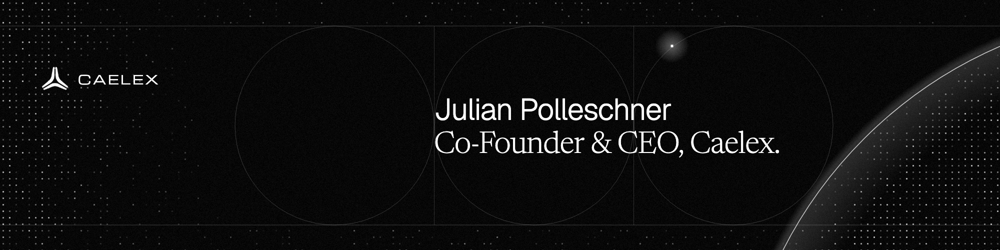

 

NOW

### Building export-control classification, with its reasoning attached.

Co-Founder & CEO of **[Caelex](https://www.caelex.eu)**. Our product, Ocular, reads a part's datasheet and returns its control-list position, the legal derivation and a signed record. We're starting with space and defence.

 

BEFORE

<table>
  <tr>
    <td width="50%" valign="top"><b>Siemens &amp; PwC</b> Supply chain management at Siemens, and PwC.</td>
    <td width="50%" valign="top"><b>Humboldt-Universität zu Berlin</b> Economics.</td>
  </tr>
</table>

 

BELIEF

### In export control, a guess is worthless.

 

[caelex.eu](https://www.caelex.eu) &nbsp;·&nbsp; [LinkedIn](https://www.linkedin.com/in/julian-polleschner-a90943281/) &nbsp;·&nbsp; [Caelex on GitHub](https://github.com/Caelex)
